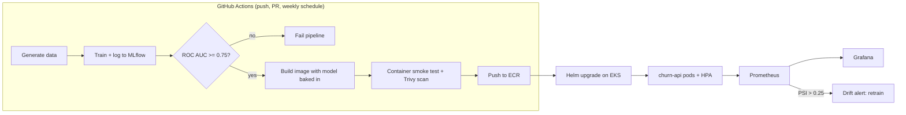

# MLOps Pipeline: Churn Prediction Model on Kubernetes

Automated lifecycle for a customer churn model: data generation, training with experiment tracking,
an automatic quality gate, container packaging, deployment to Kubernetes and live monitoring of
prediction latency and data drift.


## Architecture



## Results

Trained on 20,000 synthetic customer records with a GradientBoosting model:

| Metric | Value |
|---|---|
| ROC AUC | 0.81 |
| Precision | 0.67 |
| Recall | 0.50 |
| F1 | 0.58 |

The pipeline fails automatically if ROC AUC drops below 0.75, so a weaker model can never reach production.

## Project layout

```
data/generate_data.py   synthetic telecom churn dataset (no real customer data)
src/churn/features.py   one feature definition shared by training and serving
src/churn/train.py      trains logreg or gbm, logs params/metrics/model to MLflow, quality gate
serving/app.py          FastAPI API: /predict, /readyz, /model-info, /metrics
serving/drift.py        Population Stability Index (PSI) on a rolling window of live requests
helm/churn-api/         Deployment, Service and HPA (2 to 8 replicas at 65% CPU)
monitoring/alerts.yaml  drift and latency alerts
.github/workflows/      train, test, build, scan, deploy
```

## How drift detection works

At training time the pipeline saves the decile boundaries of `monthly_charges`. The API keeps the last
500 values it has seen and computes PSI against those deciles. The value is exported as the
`churn_feature_psi` Prometheus gauge. Above 0.25 means customers now look different from the training
data, and an alert asks for a retrain. The weekly scheduled run retrains the model anyway.

## Run it locally

```bash
pip install -r requirements-train.txt
make train            # generates data, trains, applies the quality gate
make test             # 12 tests: data checks, drift maths, API behaviour, quality gate
make serve            # API on http://localhost:8000/docs
make ui               # MLflow UI to compare runs

curl -X POST localhost:8000/predict -H 'Content-Type: application/json' -d '{
  "tenure_months": 3, "monthly_charges": 110.5, "total_charges": 331.5,
  "contract": "month-to-month", "internet_service": "fiber",
  "payment_method": "cash", "support_calls": 4, "senior_citizen": 0}'
# {"churn_probability": 0.97, "will_churn": true, "model_run_id": "..."}
```

## Deploy to EKS

The cluster and the `dev/churn-api` ECR repository come from
[terraform-aws-multi-env](https://github.com/sid9743/terraform-aws-multi-env).
The deploy job runs on `main` once the repository variable `AWS_ENABLED` is `true` and the
`AWS_DEPLOY_ROLE_ARN` secret is set (GitHub OIDC, no stored keys).

```bash
helm upgrade --install churn-api helm/churn-api -n ml --create-namespace \
  --set image.tag=<git-sha>
```

## Tech stack

Python, scikit-learn, pandas, MLflow, FastAPI, pytest, Docker, Kubernetes, Helm, Amazon EKS, Amazon ECR,
GitHub Actions, Trivy, Prometheus, Grafana
